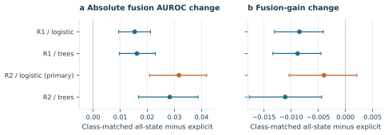

# CXR Controlled Selection

[](https://github.com/yazandabain/cxr-controlled-selection/actions/workflows/ci.yml)
[](docs/REPRODUCIBILITY.md)

Code for studying how report-conditioned training eligibility changes model comparisons, while keeping the evaluation cases and target fixed.

Requiring an explicit positive or negative report label changes which cases enter supervision. Matching training-set size alone does not control that change. This toolkit provides class-matched sampling, crossed positive/negative membership controls, bounded model fitting and patient-paired evaluation for investigating it.

This is a **research code and aggregate-results release**. It contains no patient records, clinical images, row-level labels, embeddings, predictions, fitted models or manuscript. Numerical method fixtures and the runnable model example are synthetic. Aggregate replay tests use the reviewed real summary results. It is not a clinical prediction product.

## What is included

| Component | Purpose |
| --- | --- |
| Patient selection | Deterministic selection before report eligibility is applied |
| Training panels | Nested fitting budgets; explicit, random and exactly class-matched arms |
| Report-state add-back | Compare eligibility pools that admit uncertain or blank reports |
| Crossed membership controls | Swap positive and negative sources while preserving class counts |
| Model fitting | Logistic regression and an optional bounded XGBoost comparison; validation-only tuning |
| Evaluation | Tie-aware AUROC and average precision, shared patient resampling and paired contrasts |
| Pair accounting | Decompose AUROC into within-group and cross-group pair contributions |
| Uncertainty helpers | Paired percentile intervals and approximate simultaneous bands |

These are computational helpers from the verified analysis, with safe summary results and presentation builders. The original data extraction, encoder training, cohort joins and private campaign orchestration are not distributed here. This repository reproduces the numerical tables and quantitative figures from retained aggregates, **not** the original study end to end from raw MIMIC files.

## Aggregate results and figures

The controlled comparisons keep the coded reference and test population fixed. They separate absolute fusion performance from the incremental gain over image-only models. The primary comparison and later exploratory controls are retained separately in the public summaries, including their uncertainty qualifications.



The full values are in [aggregate results](results/aggregates) and [readable tables](results/tables). To rebuild all quantitative figures and numerical tables without restricted inputs:

```bash
python -m pip install -c requirements-ci.txt ".[trees,figures,test]"
python scripts/build_assets.py --out ../cxr-public-assets
```

See [reproducibility details](docs/REPRODUCIBILITY.md) for the numeric ledger, figure source, runtime and limits of replay.

## Quick start

Python 3.11 or later is required. Python 3.13 is the locally tested version. Use an isolated environment.

```bash
python -m venv .venv
# Windows PowerShell
.venv\Scripts\Activate.ps1
# Linux or macOS, instead
source .venv/bin/activate

python -m pip install -c requirements-ci.txt -e ".[trees,figures,test]"
python -m unittest discover -s tests -v
python examples/synthetic_study.py
```

The example generates synthetic patients in memory, selects equal-size and class-matched training arms, fits image-like and combined-feature logistic models, then compares them on the same synthetic test target. Its output is printed, not saved. No dataset, pretrained weights or credentials are downloaded. The numbers are demonstration output, not study findings.

For logistic-only use, install with `python -m pip install -e .`. The complete suite needs the `trees`, `figures` and `test` extras. Installation downloads normal Python dependencies, not study data.

## Using the methods

```python
from cxr_selection.models import sample_training_panels, fit_logistic
from cxr_selection.evaluate import CachedMetric
from cxr_selection.refit_sensitivity import patient_weights

# Arrays below must come from your own authorized, patient-disjoint partitions.
panels = sample_training_panels(
    patient_ids, report_states, train_target,
    budgets=(128, 256), seeds=(0, 1, 2),
)
idx = panels[0][256]["prevalence_matched"]
fit = fit_logistic(
    X_train[idx], train_target[idx], X_validation, validation_target, X_test,
)
metric = CachedMetric(test_target, fit["test_probabilities"])
```

`report_states` uses `1` for an explicit positive report label, `0` for an explicit negative label, `-1` for uncertainty and `NaN` for a blank label **in an available source row**. Missing source rows must be handled separately before calling the sampler. The binary `train_target` is a separate reference; report state determines eligibility, not the target value.

The explicit and class-matched arms have the same number of supervised patients and the same target-positive count within each seed and budget. Their memberships need not be disjoint. The code does not infer disease truth from a report state.

## Repository layout

```text
src/cxr_selection/   Selection, model and statistical helpers
tests/              Synthetic numerical and sampling tests
examples/           Small in-memory demonstration
docs/               Method details and authorized-data access guidance
scripts/            File and Git-history release check
results/aggregates/  Reviewed real summary results, with private hashes removed
results/tables/      Rebuilt CSV and Markdown numerical tables
figures/            Aggregate-derived exports and editable study diagram
.github/workflows/  Fresh-checkout tests and aggregate replay
```

## Interpretation and safeguards

- Compare arms against one fixed evaluation target and population. Changing either can change AUROC or average precision without demonstrating a training-selection effect.
- Keep patients separate through supervised pretraining, training, validation and testing. The model helpers expect prepared numeric matrices; they do not enforce upstream separation or fit preprocessing.
- Fit preprocessing on an appropriate training-only population. State whether transforms are shared across arms or refitted within each selected panel.
- Report absolute performance and fusion-minus-image gains separately. A larger absolute score does not necessarily mean a larger fusion gain.
- Patient resampling must be shared across compared predictions. Fixed-prediction bootstrap intervals condition on the fitted models and selected training panels; they are not full-pipeline uncertainty.
- Pair accounting is descriptive. It does not identify why an eligibility rule changes predictions or establish a causal mechanism.

See [method details](docs/METHODS.md) and [data access](docs/DATA_ACCESS.md). Any sensitive outputs generated in your own use belong outside this repository.

## Citation and rights

Software citation metadata is in [CITATION.cff](CITATION.cff). No manuscript, journal acceptance, DOI or clinical-validation claim is implied.

No repository-wide open-source license has been granted. See [NOTICE.md](NOTICE.md) and [third-party terms](THIRD_PARTY.md). Dependencies and embedded figure fonts retain their own terms. A code license can be added after the relevant rights holders approve it; public visibility alone does not grant an open-source license.
